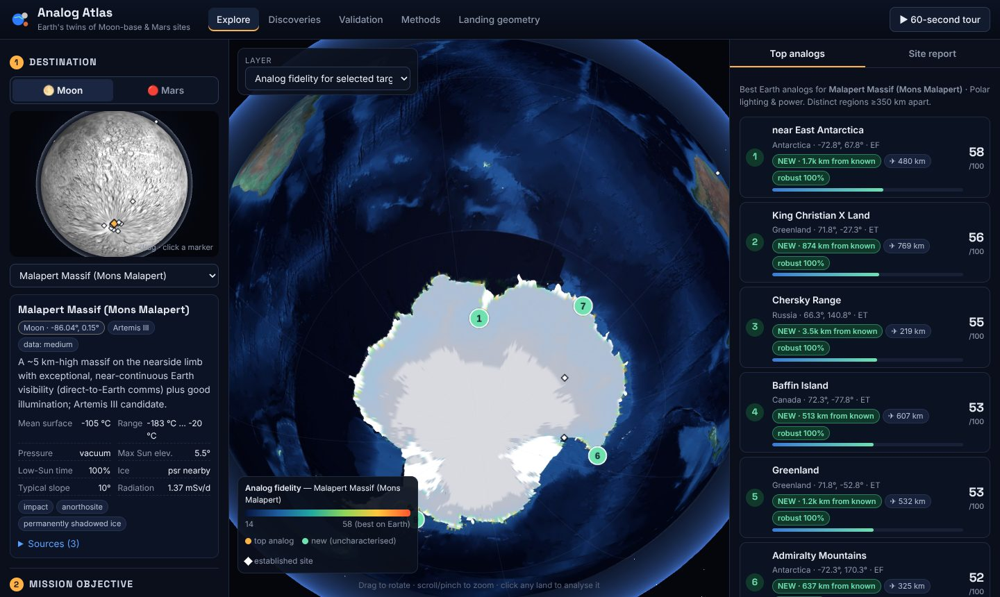
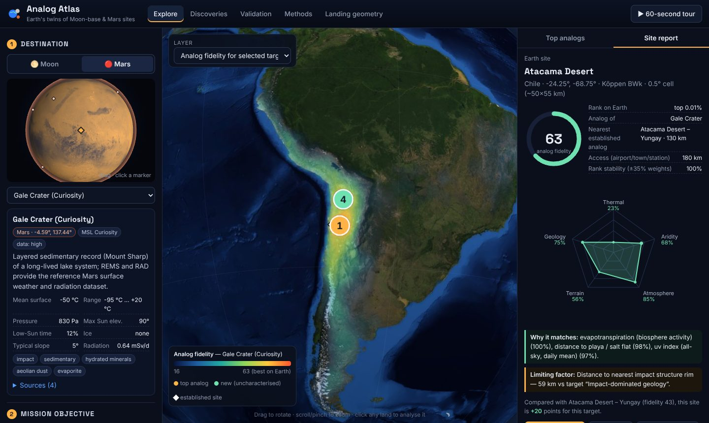
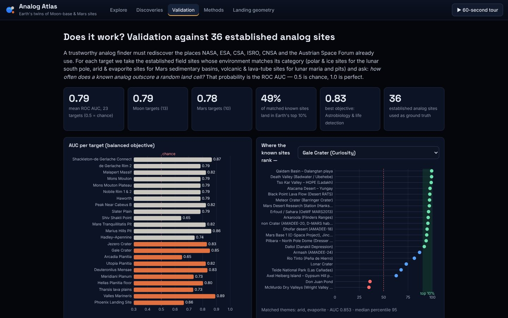
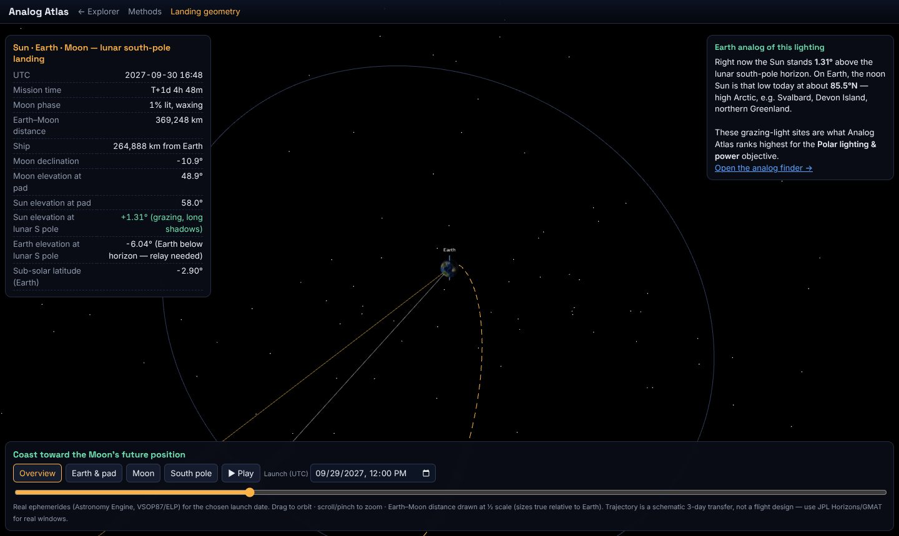

# 🌍🌕🔴 Analog Atlas

**Find Earth's twins of Artemis Moon-base regions and Mars landing sites, using open NASA data, and show your work.**

NASA Space Apps Challenge 2026 · Challenge: [*Identify Earth Locations that Analog the Permanent Moon Base Locations and Mars*](https://www.spaceappschallenge.org/2026/challenges/identify-earth-locations-that-analog-the-permanent-moon-base-locations-and-mars/)

**▶ Live demo:** https://clicktwice26.github.io/nasc/ (no install; runs entirely in the browser)



---

## The problem

Mission teams test rovers, drills, spacesuits, habitats and crews at terrestrial analogs (Devon Island, the Atacama, the McMurdo Dry Valleys) before anything flies. These sites are chosen largely by tradition and logistics. As the challenge puts it, they are *"not entirely well characterized."* Nobody can easily answer:

* *Which place on Earth is the best stand-in for the Artemis III **Malapert Massif** region if I want to test **solar power under a grazing Sun**?*
* *Is there an **uncharacterised** place that is a better Mars **ground-ice** analog than the sites we already use?*
* *How good is the Atlas analog for Mars, factor by factor, and what is its weak point?*

## What Analog Atlas does

1. **Pick a destination.** Choose from 23 cited targets: NASA's 9 Artemis III south-pole regions, the Shackleton–de Gerlache ridge, ISRO's Chandrayaan-3 Shiv Shakti point, two lunar lava-tube skylights, Apollo 15 Hadley, and 10 Mars sites (Jezero, Gale, Arcadia, Utopia/Zhurong, Deuteronilus, Meridiani, Hellas, Tharsis, Valles Marineris, Phoenix).
2. **Say what you want to test.** Six mission objectives re-weight six factor groups: base habitat, rover/EVA mobility, ISRU ice prospecting, astrobiology, polar lighting/power, and balanced. You can also fine-tune the weights yourself.
3. **Earth is re-ranked live.** All **88,648 land cells** (0.5°) are scored on **21 environmental factors** (from 32 data layers) in about 0.1 s in the browser and painted on a 3D globe.
4. **Get distinct candidates.** You get the 12 best regions at least 350 km apart. Each is flagged **NEW** if it is far from every established analog, and carries an **access** distance and a **rank-stability** score from a Monte-Carlo weight test.
5. **Read the report card.** Click any land: a factor-by-factor match against the target, a six-axis radar chart, the *limiting factor*, a head-to-head with the nearest established analog, and a **downloadable field brief** (Markdown).
6. **Check the evidence.** The Validation tab shows the method rediscovering 36 established analog sites. The Discoveries tab lists new candidates for every target.



## Key results

| | |
|---|---|
| **Mean ROC AUC 0.79** (23 targets) | A theme-matched established analog outranks a random land cell 79% of the time (0.5 = chance). Moon 0.79 · Mars 0.78 · best objective (astrobiology) 0.83. |
| **49%** of matched known sites | land in Earth's **top 10%** for their target. |
| **Atacama → Gale, Jezero, Valles Marineris** | Ranked #1 for all three under the astrobiology objective, matching decades of NASA practice. |
| **Karakoram / Tibet → Deuteronilus Mensae** | Debris-covered glaciers of High Mountain Asia: exactly the analogs used for Martian lobate debris aprons. |
| **New candidates** | The **Chersky Range** (Yakutia, permafrost desert), the **Prince Charles Mountains** oases (Antarctica), **Baffin Island**, the **Pamir/Kunlun**, and the **Tibesti** and **Ahaggar** volcanic massifs recur across many targets, yet lie 300–3,500 km from any established analog. |



## How it works (short version, full write-up in [`methods.html`](methods.html))

```
open data ─► 0.5° feature grid ─► target → Earth ideal ─► percentile-space scoring ─► validation & app
NASA POWER    32 layers, 6.6 MB     clamp to Earth's        6 factor groups,           36 known sites,
ETOPO, ...    pipeline/build.py     attainable envelope     weighted geometric mean    ROC AUC, Monte-Carlo
```

* **Earth data.** NASA POWER climatologies (MERRA-2, CERES SYN1deg, GPM IMERG) are read directly from NASA's AWS Open Data bucket. They give temperature regime, diurnal range, precipitation, humidity, pressure, UV, albedo, cloud, frost days, permafrost proxy, soil wetness, evapotranspiration and wind. These are combined with NOAA ETOPO1 relief and slope, solar-geometry lighting, the Köppen–Geiger climate class, the GLOBE land mask, and geology proximity: Earth Impact Database craters, OSM volcanoes, Natural Earth playas and glaciers. Accessibility comes from airports, towns and COMNAP stations.
* **Planet-to-Earth translation.** A −120 °C, airless lunar ridge has no Earth equal. Each target condition is therefore clamped to Earth's attainable envelope (1st–99th percentile): "as cold, dry and thin-aired as Earth gets." Lighting is *computed* from each body's obliquity, so the lunar pole's ~1.5° Sun maps onto Earth's high latitudes on equal terms.
* **Similarity in percentile space.** `s = (1 − |F(x) − F(x*)|)³`, where F is Earth's land-cell distribution of that feature. The measure is unit-free, robust to skewed data and needs no hand-tuned tolerances. Geology uses distance-decay kernels.
* **Non-compensatory aggregation.** Groups are combined with a weighted geometric mean, so a hot desert can't buy back being 70 °C too warm for a polar target with dryness. A substrate gate stops ice sheets from passing as regolith.
* **Validation built in.** The ROC AUC against theme-matched established sites, the negative controls (Amazon, Congo, Paris, Singapore), and a regression guard all run in CI (`npm test`).

## Space-agency data used

* **NASA:** POWER / MERRA-2 / CERES / GPM IMERG, Blue Marble Next Generation, NASA 3D Resources Mars map. Target values come from LRO Diviner, LOLA and LAMP, MSL REMS/RAD, Mars 2020 MEDA, Phoenix and SHARAD/SWIM, and from the Artemis III region list (Oct 2024).
* **ISRO:** Chandrayaan-3 ChaSTE surface temperatures (Shiv Shakti point). **CNSA:** Zhurong meteorology and Chang'e-4 LND radiation dose.
* Established analog catalogue: NASA, ESA, CSA, ISRO, CNSA, the Austrian Space Forum (OeWF) and the Mars Society. Full sources are in `data/targets.json` and `data/analogs.json`.

## Also included: lunar landing geometry

[`mission.html`](mission.html) began as our original Sun–Earth–Moon landing visualiser. It now uses **real ephemerides** (Astronomy Engine): pick a launch date and it computes the actual Sun elevation at the lunar south pole (about ±1.5°), whether Earth is above the horizon for direct-to-Earth communications, the Sun and Moon elevations at the KSC pad, and **the Earth latitude where the noon Sun is equally low that day**. That latitude links straight back to the analog finder.



## Run it locally

```bash
python3 -m http.server 8000     # then open http://localhost:8000
npm test                        # engine tests + validation regression guard (Node ≥ 20)
```

Rebuild the data from scratch (about 270 MB of open inputs, no API keys):

```bash
pip install -r pipeline/requirements.txt
python3 pipeline/fetch.py && python3 pipeline/build.py && node tools/evaluate.mjs
```

## Repository map

| Path | What |
|---|---|
| `index.html`, `js/app.js`, `css/app.css` | The explorer, discoveries and validation views |
| `js/engine.js` | Scoring engine (pure functions, shared by browser, worker and tests) |
| `js/globe.js`, `js/charts.js`, `js/worker.js` | three.js globes, SVG charts, Monte-Carlo rank-stability worker |
| `pipeline/fetch.py`, `pipeline/build.py` | Reproducible data pipeline → `data/earth.bin` + `data/earth.json` |
| `data/targets.json`, `data/analogs.json` | 23 cited planetary targets · 38 established analog sites |
| `tools/evaluate.mjs` | Validation and discovery run → `data/validation.json`, `data/discoveries.json` |
| `tests/engine.test.mjs` | 12 tests incl. physical sanity, controls and the AUC regression guard |
| `methods.html` | Full methodology, data inventory, limitations, roadmap, credits |
| `mission.html` | Lunar south-pole landing geometry with real ephemerides |
| `docs/PITCH.md` | Judging pitch: slides outline and 30-second demo script |

## Honest limitations

A 0.5° cell is about 50 km across. Analog Atlas is a **regional screening tool** that says *where to look*; outcrop-scale fidelity needs finer data and fieldwork. Climate comes from reanalysis, geology is proxied by mapped features rather than mineralogy, and several planetary values are flagged as medium/low-confidence estimates. See [methods §8](methods.html#limits).

## Credits & licences

NASA POWER (MERRA-2/GMAO, CERES/LaRC, GPM IMERG); NASA Blue Marble; NOAA ETOPO1 via Fatiando a Terra; Köppen–Geiger (Rubel et al. 2017, kgcpy); GLOBE land mask; Natural Earth (public domain); Earth Impact Database (PASSC); © OpenStreetMap contributors (ODbL); COMNAP; three.js and Astronomy Engine (MIT, vendored). Original code: MIT.
*NASA does not endorse any non-government entity and is not responsible for information contained on non-U.S. Government websites.*
